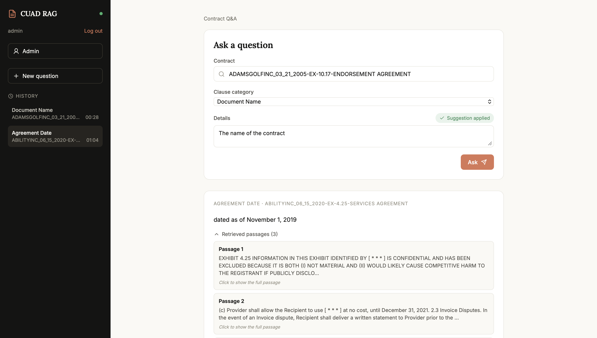
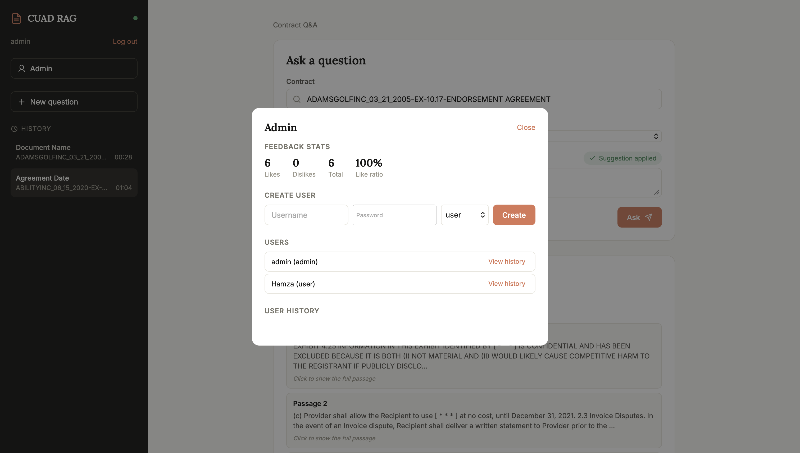
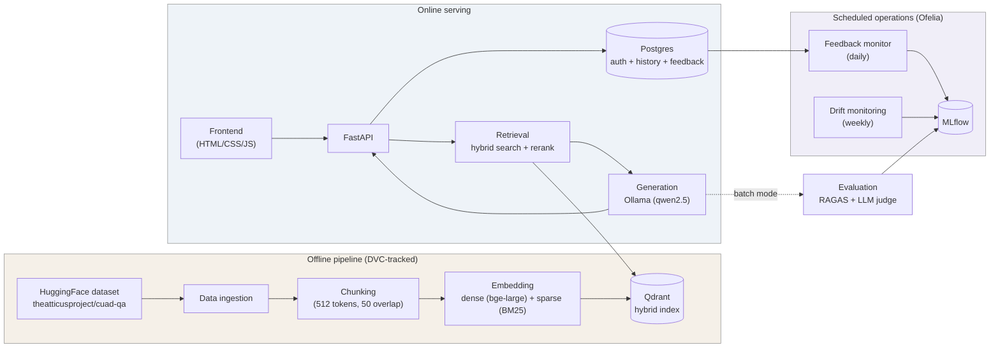
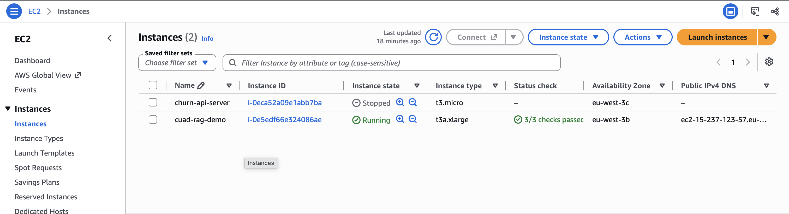

# CUAD RAG — Contract Understanding Q&A

A Retrieval-Augmented Generation system that answers legal questions over real commercial contracts, built on the [CUAD (Contract Understanding Atticus Dataset)](https://huggingface.co/datasets/theatticusproject/cuad-qa). The project is less about the model and more about the system around it: a versioned data pipeline, hybrid retrieval, automated evaluation, a feedback loop, drift monitoring, and a full containerized deployment to the cloud — the complete lifecycle an ML feature needs to run in production, not just in a notebook.

**Status: v1 baseline.** Retrieval, generation, evaluation, monitoring, auth and deployment are all working end to end. Model/prompt quality and an agentic phase are active areas of ongoing work (see [Roadmap](#roadmap)).


---

## Overview

Given a contract and a clause category (e.g. *Governing Law*, *Termination For Convenience*, *Document Name*...), the system retrieves the relevant passages from that specific contract and generates a grounded answer with a local LLM — no answer is produced without supporting evidence from the document itself. Every answer is tied back to the clause category it belongs to, since CUAD questions are organized around 41 standardized clause types used in contract review.

Around that core Q&A loop, the project implements the surrounding machinery a real deployment needs:

- A **DVC-tracked pipeline** so every artifact (chunks, embeddings, index, eval results) is reproducible and tied to the parameters that produced it.
- **Hybrid retrieval** (dense + sparse) with a reranking step, and a retrieval depth that adapts to how hard a clause category is.
- **Automated evaluation** combining the RAGAS framework with an LLM-as-judge for a check RAGAS doesn't do well: whether the system correctly says "not present" when a clause is genuinely absent.
- A **feedback loop and drift monitoring**, scheduled to run on their own and log results to MLflow, so quality can be watched over time instead of only at training time.
- A full **Docker Compose stack** (vector DB, relational DB, experiment tracker, API, scheduler) deployed to a single AWS EC2 instance.

## Screenshots

| Answering a question with retrieved evidence | Admin panel — feedback stats & user management |
|---|---|
|  |  |

The frontend is intentionally minimal (vanilla HTML/CSS/JS served directly by FastAPI, no frontend framework or build step) — session-cookie auth, per-user history, an autocomplete contract picker, and an admin view with feedback stats and user management (admin/user RBAC).

## Architecture



Everything runs as Docker Compose services — `qdrant`, `postgres`, `mlflow`, `api` (the FastAPI app + static frontend), and `scheduler` (Ofelia, running the feedback/drift jobs inside the `api` container on a cron-like schedule). This exact stack is what's deployed as-is to a single AWS EC2 instance (see [Deployment](#deployment)).

## Key features

- **Hybrid retrieval**: dense embeddings (`BAAI/bge-large-en-v1.5`) combined with sparse BM25 (`Qdrant/bm25`) in a single Qdrant collection, followed by cross-encoder reranking (`BAAI/bge-reranker-v2-m3`).
- **Category-aware retrieval depth**: most clause categories use a standard top-k, but a set of harder "tier 3" categories (e.g. *IP Ownership Assignment*, *Non-Compete*, *Rofr/Rofo/Rofn*) retrieve and rerank a wider pool of candidates before answering.
- **Optional reasoning step**: the generation prompt can force the model to state which passage supports its answer before answering, trading latency for a (usually) better-grounded response — toggleable via config.
- **Evaluation beyond RAGAS**: standard RAGAS metrics (faithfulness, answer relevancy, context precision/recall, answer correctness) plus a dedicated **LLM-judge check for negative cases** — i.e., contracts where the clause category genuinely doesn't apply, where the only correct answer is some form of "not present."
- **Feedback loop + drift monitoring**: user 👍/👎 feedback is persisted, and two scheduled jobs (daily feedback review, weekly drift evaluation) re-run the evaluation pipeline and log fresh metrics to MLflow — so regressions are visible over time, not just at the last training run.
- **Auth & RBAC**: cookie-session authentication, PBKDF2-hashed passwords, admin/user roles, per-user Q&A history.
- **Fully containerized, cloud-deployed**: the same `docker-compose.yml` runs locally and on a single AWS EC2 instance, started/stopped on demand to control cost.

## Tech stack

| Layer | Tools |
|---|---|
| Data & config | HuggingFace `datasets`, pandas, PyYAML, `python-box`, DVC |
| Embeddings & retrieval | `sentence-transformers`, LlamaIndex, Qdrant (hybrid dense + sparse), `fastembed` (BM25) |
| Generation | Ollama (local LLM serving), `qwen2.5` |
| Evaluation | RAGAS, Anthropic Claude (LLM judge), `nomic-embed-text` |
| Backend | FastAPI, Uvicorn, psycopg2, `itsdangerous` (signed session cookies) |
| Frontend | Vanilla HTML / CSS / JS (no framework, no build step) |
| Experiment tracking | MLflow (Postgres backend store, filesystem artifact store) |
| Orchestration & scheduling | Docker Compose, Ofelia (cron-like job scheduler for containers) |
| Testing & quality | pytest (unit + integration), ruff |
| Infra / deployment | Docker, AWS EC2 |

## Pipeline stages

The core pipeline is defined as DVC stages (`dvc.yaml`) and can also be run directly via `python main.py <stage>`:

| Stage | What it does | Why |
|---|---|---|
| `data_ingestion` | Downloads the CUAD dataset from HuggingFace, deduplicates contracts, cleans text | One canonical, versioned source of truth for all downstream stages |
| `chunking` | Splits cleaned contracts into 512-token chunks (50-token overlap), tokenized with `bge-small-en-v1.5` | Chunk boundaries aligned with the embedding model's own tokenizer |
| `embedding_indexing` | Embeds chunks with a dense model and a sparse BM25 model, indexes both into a single Qdrant collection | Hybrid search catches both semantic matches and exact-term matches (contract language is often exact-phrase-sensitive) |
| `eval_samples` | Samples positive (clause present) and negative (clause absent) question/contract pairs per category | Evaluation needs both cases — most RAG evaluation setups only check the positive case |
| `generation` | Runs retrieval + generation in batch over the sampled questions | Produces the raw answers that get scored in the next stage |
| `evaluation` | Scores answers with RAGAS, plus an LLM-judge pass dedicated to negative-case correctness; logs everything to MLflow | Positive and negative cases need different scoring logic — RAGAS alone doesn't reliably detect "model hallucinated a clause that isn't there" |

Two more stages run **operationally** rather than as part of the DVC pipeline — scheduled inside the running container via Ofelia, not triggered by `dvc repro`:

| Stage | Schedule | What it does |
|---|---|---|
| `feedback_monitor` | Daily | Reviews recent user feedback (👍/👎) collected through the app and logs a summary to MLflow |
| `drift_monitoring_evaluation` | Weekly | Re-runs the evaluation pipeline on a fresh sample and logs it to MLflow under its own experiment, so metric trends over time are comparable run to run |

## Results

Current v1 baseline, aggregated RAGAS scores across sampled positive and negative cases:

| Metric | Score |
|---|---|
| Faithfulness | 0.69 |
| Answer relevancy | 0.65 |
| Context precision | 0.64 |
| Context recall | 0.70 |
| Answer correctness | 0.49 |

These are first-baseline numbers, not a tuned result — retrieval parameters, prompting, and the generation model are all still being iterated on (see [Roadmap](#roadmap)). They're published here rather than hidden because tracking them honestly, version over version, is the point of having MLflow and a monitoring loop in the first place.

## Repository structure

```
├── main.py                    # CLI entrypoint: python main.py <stage>
├── config/config.yaml         # paths & infra config (non-tunable)
├── params.yaml                 # tunable hyperparameters (tracked by DVC)
├── dvc.yaml / dvc.lock         # pipeline definition & reproducibility lock
│
├── src/
│   ├── components/            # core logic: chunking, embedding_indexing,
│   │                           # retrieval, generation, evaluation, feedback_monitor
│   ├── pipeline/               # thin orchestration wrappers around each component
│   ├── config/                 # ConfigurationManager (yaml -> typed config objects)
│   ├── entity/                 # dataclasses describing each stage's config
│   ├── api/                    # FastAPI app: main, auth, admin, schemas
│   └── frontend/static/        # HTML/CSS/JS served by FastAPI
│
├── docker/
│   ├── docker-compose.yml      # qdrant, postgres, mlflow, api, scheduler
│   ├── api.Dockerfile
│   └── mlflow.Dockerfile
│
├── tests/
│   ├── unit/
│   └── integration/
│
└── notebook/                   # exploratory notebooks (EDA, early experiments)
```

## Getting started

### Run the full stack with Docker Compose

```bash
cp .env.example .env     # fill in POSTGRES_* and ANTHROPIC_API_KEY, add SESSION_SECRET_KEY / BOOTSTRAP_ADMIN_* (see below)
cd docker
docker compose up -d --build
```

This starts Qdrant (`:6333`), Postgres (`:5432`), MLflow (`:5001`), the API + frontend (`:8000`), and the Ofelia scheduler. Ollama itself runs on the host (not inside Compose) — install it separately and make sure the model named in `params.yaml` (`generation.llm_model_name`) is pulled (`ollama pull qwen2.5:7b`).

Required environment variables (`.env`):

| Variable | Purpose |
|---|---|
| `POSTGRES_USER` / `POSTGRES_PASSWORD` / `POSTGRES_DB` | Shared by the `postgres`, `mlflow`, and `api` services |
| `ANTHROPIC_API_KEY` | Claude, used as the LLM judge in evaluation |
| `SESSION_SECRET_KEY` | Signs session cookies |
| `BOOTSTRAP_ADMIN_USERNAME` / `BOOTSTRAP_ADMIN_PASSWORD` | First admin account, created on API startup |

### Run a single pipeline stage

```bash
python main.py chunking          # any stage name from dvc.yaml
dvc repro                        # or let DVC run only what's out of date
```

## Deployment



The same `docker-compose.yml` is deployed as-is on a single AWS EC2 instance (Ubuntu 24.04, sized to run the whole stack — vector DB, relational DB, experiment tracker, API, and the local LLM — on one box), started and stopped on demand rather than left running continuously. A few deployment-specific details worth calling out:

- **Linux Docker networking**: unlike Docker Desktop, native Linux Docker doesn't resolve `host.docker.internal` automatically — it needs `extra_hosts: ["host.docker.internal:host-gateway"]` in the Compose file, and Ollama must be told to bind `0.0.0.0` instead of `127.0.0.1` (via a systemd override) to be reachable from containers.
- **Memory**: running the embedding model, reranker, Qdrant, Postgres, MLflow, and a 7B-parameter LLM on one modestly-sized instance is tight. A swap file was added as a safety net against OOM kills, and `OLLAMA_KEEP_ALIVE` is set so the model isn't repeatedly unloaded/reloaded between requests (reloading it from disk costs tens of seconds on its own).
- **No GPU**: the LLM runs on CPU only, which is the main latency bottleneck in this deployment — this is a known, accepted tradeoff for a free/low-budget learning deployment, not a target end state.
- **Cost control**: no Elastic IP is reserved, so the instance's public IP changes on every stop/start — intentional, since the instance is only started for active use and stopped otherwise to minimize cost.

## Testing & code quality

```bash
pytest           # unit + integration tests
ruff check .     # linting
```

Integration tests run against a real Postgres instance rather than mocks, to catch schema/query issues mocks would hide.

## Roadmap

This is **v1**: a complete, working, evaluated, monitored, and deployed RAG baseline. Planned next:

- An **agentic phase** — moving from a single retrieve-then-generate call to a model that can decide how to investigate a contract (e.g. issue multiple targeted retrievals, cross-check clauses) before answering.
- Continued exploration of **retrieval and generation configurations** — alternative models, prompting strategies, and retrieval parameters — to improve on the v1 baseline scores above.
